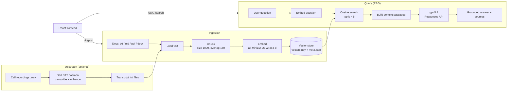

# Knowledge Base Pipeline

This document describes how the ZESCO knowledge base turns raw documents and
call transcripts into grounded, cited answers.

## Overview

The system has two cooperating pieces:

- **`kb-service`** — a FastAPI backend that ingests documents, embeds them into a
  local vector index, and answers questions using retrieval-augmented
  generation (RAG).
- **`kb-frontend`** — a React + TypeScript single-page app (Ask / Search /
  Ingest) that talks to the backend over HTTP.

Upstream, the call-centre pipeline (STT daemon in `dart-ari`) produces the
transcripts that feed the knowledge base, but the KB also accepts any
`.txt`, `.md`, `.pdf`, or `.docx` document (policies, SOPs, FAQs).

## Who uses it

The end users are **ZESCO call-centre agents**. While a customer is on the
line and asks a tough question, the agent queries the knowledge base and gets a
concise, grounded answer they can relay directly to the caller — with the
source documents cited. The `gpt-5.4` system prompt is written for this
scenario: answer only from retrieved context, phrase it for the caller, and if
the information is missing, tell the agent to escalate rather than guess.


## End-to-end flow



## Ingestion pipeline

1. **Load** — `app/loaders.py` extracts plain text per file type:
   - `.txt` / `.md`: read directly (UTF-8, errors ignored)
   - `.pdf`: `pypdf` page text
   - `.docx`: `python-docx` paragraph text
2. **Chunk** — `app/chunking.py` splits text into overlapping windows
   (default `CHUNK_SIZE=1000` chars, `CHUNK_OVERLAP=150`). Overlap preserves
   context across chunk boundaries.
3. **Embed** — `app/store.py` encodes each chunk with the local
   `sentence-transformers/all-MiniLM-L6-v2` model (384-dim, L2-normalized so a
   dot product equals cosine similarity). Runs offline — no Azure call.
4. **Store** — vectors are appended to `vectors.npy` and chunk metadata
   (`source`, `path`, `chunk_index`, `text`) to `meta.json`, both under
   `KB_DATA_DIR` (default `./kb_data`). Re-ingesting a source first removes its
   old chunks (`remove_source`) so updates stay clean.

## Query pipeline (RAG)

1. **Embed the question** with the same model.
2. **Retrieve** the top-`k` (default 5) most similar chunks by cosine score.
3. **Assemble context** — each passage is labelled with its source file.
4. **Generate** — `app/rag.py` calls the Azure AI Foundry `gpt-5.4` model via
   the OpenAI-compatible Responses API with a system prompt that forces answers
   to use only the retrieved context and to say "I don't have that information"
   rather than guessing.
5. **Return** the answer plus the list of source files it relied on.

## HTTP API

| Method | Path             | Purpose                                             |
| ------ | ---------------- | --------------------------------------------------- |
| GET    | `/health`        | Status, document count, sources, embed model        |
| POST   | `/ingest/path`   | Ingest a file or every supported file under a folder |
| POST   | `/ingest/upload` | Ingest an uploaded document (multipart)              |
| POST   | `/search`        | Semantic search → ranked passages with scores        |
| POST   | `/ask`           | RAG answer with cited sources                        |

CORS is open by default (`KB_CORS_ORIGINS=*`) so the browser frontend can call
the API; restrict it in production.

## Inputting documents

Documents get into the knowledge base three ways, all running the same
**load → chunk → embed → store** pipeline. Re-ingesting a file is safe: the
store removes that source's old chunks first, so updates never duplicate.

1. **Upload via the web UI** (ad-hoc) — the **Ingest** tab → "Upload a document"
   sends a single `.txt/.md/.pdf/.docx` file to `POST /ingest/upload`. Best for a
   supervisor dropping in a new policy or FAQ; no server access needed.
2. **Ingest a server path** (bulk) — the **Ingest** tab → "Ingest a server path"
   (or `POST /ingest/path`) points the API at a file **or a whole folder** on the
   API host; it walks the tree and ingests every supported file (e.g.
   `/u01/transcripts` or a `policies/` share).
3. **CLI bulk ingest** (scripted/scheduled) —
   `uv run python ingest_cli.py "C:\path\to\policies"`. This is what a cron job or
   systemd timer runs to re-index documents automatically.

### Recommended setup for ZESCO

| Content type                                        | How it gets in                                 | Cadence          |
| --------------------------------------------------- | ---------------------------------------------- | ---------------- |
| Policies, SOPs, tariff schedules, FAQs (PDF/Word)   | Curated folder on the server (e.g. `/u01/kb_docs`), ingested via path/CLI | On change / weekly |
| Call transcripts (`/u01/transcripts`)               | Path ingest or CLI pointed at the folder       | Nightly cron     |
| One-off additions by a supervisor                   | Upload tab in the UI                           | As needed        |

Keep a single **source-of-truth folder** (e.g. `/u01/kb_docs`) that supervisors
drop approved documents into, and run a nightly job that ingests it, so the KB
always reflects the approved document set and agents never get answers from
stale or unapproved material.

> Note: ingestion currently adds and updates sources but does not prune files
> that were deleted from disk. Removing a document from the index requires a
> re-sync step (not yet implemented).

## Configuration

Set in `kb-service/.env` (see `app/config.py` for defaults):

| Variable             | Default                                        | Meaning                        |
| -------------------- | ---------------------------------------------- | ------------------------------ |
| `AZURE_AI_ENDPOINT`  | `…/openai/v1`                                  | Foundry OpenAI-compatible base |
| `AZURE_AI_DEPLOYMENT`| `gpt-5.4`                                       | Chat model for answers         |
| `AZURE_AI_KEY`       | — (falls back to `AZURE_SPEECH_KEY`)           | API key                        |
| `KB_EMBED_MODEL`     | `sentence-transformers/all-MiniLM-L6-v2`       | Local embedding model          |
| `KB_DATA_DIR`        | `./kb_data`                                     | Where the index is persisted   |
| `KB_CHUNK_SIZE`      | `1000`                                          | Chunk size (chars)             |
| `KB_CHUNK_OVERLAP`   | `150`                                           | Chunk overlap (chars)          |
| `KB_TOP_K`           | `5`                                             | Passages retrieved per query   |
| `KB_CORS_ORIGINS`    | `*`                                             | Allowed browser origins        |

## Running locally

```powershell
# Backend (port 8080)
cd kb-service
uv run uvicorn app.main:app --host 0.0.0.0 --port 8080

# Bulk ingest a folder
uv run python ingest_cli.py "C:\path\to\documents"

# Frontend (port 5173)
cd ..\kb-frontend
npm install
npm run dev
```

The frontend reads `VITE_API_BASE` (default `http://localhost:8080`).

## Notes & limitations

- The vector store is a simple numpy cosine index — fine up to ~100k chunks on
  one node. For larger corpora, swap in FAISS and add a reranker.
- The first embedding call downloads the ~80 MB model; afterwards it runs fully
  offline.
- Answers are only as good as what has been ingested; if the KB lacks the
  information, the model is instructed to decline rather than hallucinate.
